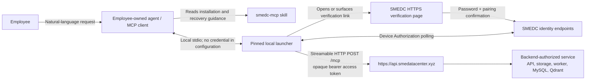
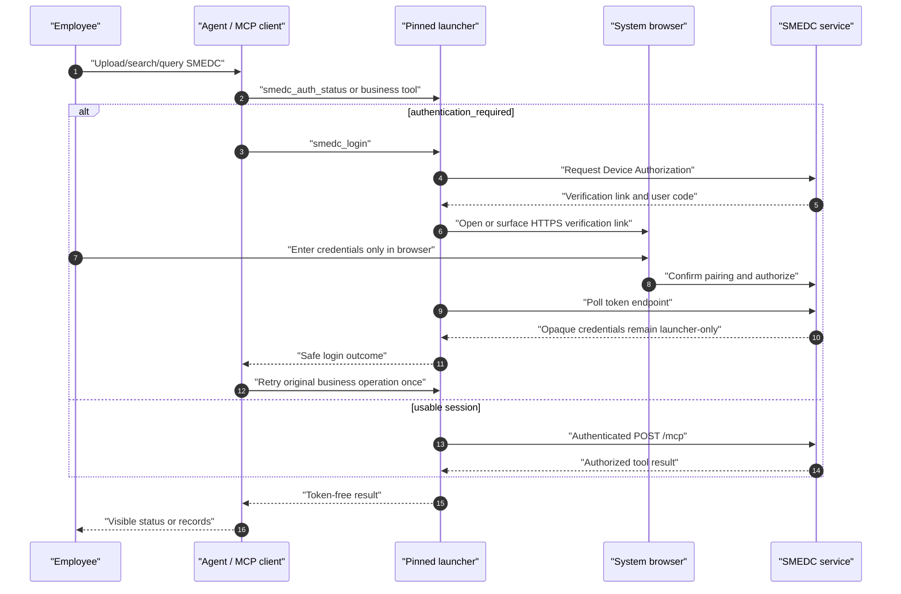

# SMEDC MCP User Flow

> **Release note:** `smedc-mcp-launcher@0.5.0` is publicly published and independently
> verified. It is the pinned distribution for the confidentiality-level contract.
> Native macOS/Windows package acceptance and the headless Linux loop pass; user-visible OpenClaw
> and support-class-C phone/browser acceptance remain release evidence. There is no
> development-login or JWT compatibility path.

Last updated: 2026-09-13

This document describes the employee-facing trust boundary, not a service-operations runbook. The
authoritative agent runbook is the dual-homed `smedc-mcp` skill. The official remote origin
is `https://api.smedatacenter.xyz`; the only approved launcher distribution is
`smedc-mcp-launcher@0.5.0`.

## Participants And Credential Boundary

| Boundary             | Credential rule                                                                                                                                                                     |
| -------------------- | ----------------------------------------------------------------------------------------------------------------------------------------------------------------------------------- |
| Employee -> agent    | The employee requests an action, but never gives a password, token, authorization code, or credential-store record to the agent.                                                    |
| Agent -> launcher    | The configured local stdio entry contains no secret. The agent may invoke only `smedc_login`, `smedc_logout`, and `smedc_auth_status` for session lifecycle.                        |
| Launcher -> browser  | The employee enters a password and confirms the agent instance only in the SMEDC HTTPS page; the browser never returns credentials through the agent/model.                         |
| Launcher -> API/MCP  | The launcher polls the token endpoint, protects and attaches opaque access tokens, and uses Keychain/Credential Manager or memory-only custody on genuinely headless hosts.         |
| MCP -> business data | Every request is authenticated and backend-authorized. The skill/launcher never directly operate API infrastructure, database, Qdrant, storage, Docker, worker, or cloud resources. |

## Installation Or Update

1. The employee asks their agent to install, update, or repair SMEDC.
2. The agent confirms macOS or Windows, checks current-user Node.js/npm availability, and uses the
   skill-approved exact launcher package in the platform versioned directory.
3. Before modifying the invoking agent's MCP configuration, it inspects and creates a backup.
   It then adds only an `smedc` **stdio** entry for the pinned launcher and leaves all
   unrelated entries unchanged.
4. Codex uses its supported current configuration mechanism. OpenClaw uses
   `openclaw mcp add`/`set`, then `openclaw mcp doctor smedc --probe`; it does not use
   direct remote OAuth storage. Other agents use guarded adaptive discovery and stop if their
   safe stdio configuration mechanism cannot be established.
5. The agent runs the launcher's credential-free self-check and reloads/restarts the MCP client as
   needed. It never lets the launcher self-update or installs npm `latest`.

## Login And One-Retry Recovery

`authentication_required` means the agent calls `smedc_login`, waits for browser
completion, and retries the original operation once. Browser cancellation, timeout, or failed login
ends that attempt without an automatic browser loop or business-operation retry. `service_unavailable`
means the agent reports the connection failure and does not open a browser or repair service
infrastructure. `forbidden` and not-found results do not prove hidden data exists.

`smedc_logout` is explicit. It removes the shared current-OS-user local session and asks
the service to revoke it when reachable, which signs out all SMEDC agents sharing that
secure-store record. Removing one agent's MCP entry is not logout; complete uninstall is a separate,
explicitly authorized lifecycle action.

## Business Tool Use

- For “which account is logged in?” questions, call zero-input
  `smedc_get_current_user`; return only its display name, email, role, and clearance. Do not infer
  identity from local configuration or accept an employee selector.
- At upload, set `confidentialityLevel` only when the employee explicitly supplies one; otherwise
  omit it and the service records level `0`. It is an integer from `0` through `3`, not a label.
  Never infer or raise it from a filename, document content, or provenance. Do not supply an
  organization ID.
- Read only a user-selected or explicitly assigned file's exact bytes. Prefer the launcher's
  `file.encoding="path"` input with an absolute local path; use inline base64 only for small files.
  Never reconstruct, normalize, translate, or retype the content.
- Status polling is allowed only to observe service state. Do not start workers or operate any
  SMEDC service component.
- After a text/evidence or structured-table upload returns `202`, keep its Document ID and, for a
  structured upload, ImportBatch ID. Poll the matching status tool after 2 seconds, then 5 seconds,
  then 10 seconds, then every 15 seconds, up to 10 minutes. Report success only at a terminal
  success state; safely summarize `rejected`/`failed` with correction advice. At 10 minutes without
  a terminal result, say still processing with the IDs and how to check later; do not report failure
  or re-upload instead of polling.
- Reuse a structured-import idempotency key only for exact replay. Treat an import-status 404 as
  not visible or missing, without inferring a hidden batch.
- For structured queries, discover the dataset registry first, send only `canonicalName` field
  values, and use source columns or aliases only to understand the user's wording or label result
  columns.
- `describe_structured_dataset_coverage` reports currently readable applied source windows or
  snapshots for one dataset. It is source coverage, not a completeness guarantee or automatic
  answer-quality verdict; the agent decides whether to query, narrow, or ask a clarification.
- Treat evidence cursors as opaque same-query continuations. On `INVALID_CURSOR`, restart without
  it. On `CURSOR_EXPIRED`, explain the expiry and restart only if the employee still wants more.
- `smedc_list_skills` returns directory metadata only. Do not execute an entry, generate a
  report, or turn SMEDC into a direct employee-facing AI service.

## Current Release Boundary

The code implements OAuth Device Authorization, opaque access tokens, rotating durable credentials,
desktop secure-store and headless memory-only custody, public HTTPS `/mcp`, and the pinned launcher.
The staging migration, official-session fixture smoke, native macOS/Windows package acceptance, and
headless Linux login-to-business-tool loop have passed. Full user-visible OpenClaw and
support-class-C phone/browser acceptance remain. The retained Authorization Code + PKCE endpoints
serve minimum-compatible 0.1.x launchers only; removed `/auth/dev-login`, JWT, and local email-login
tools must remain absent.
