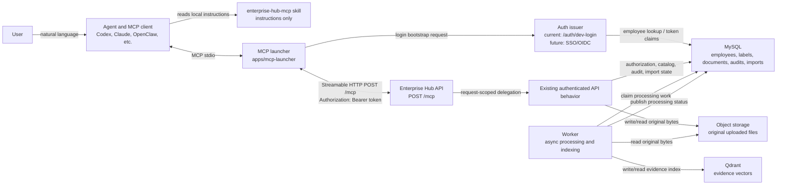
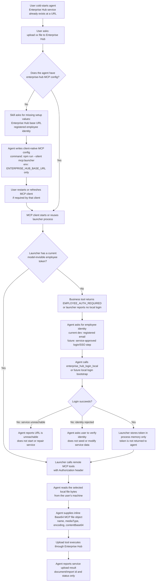
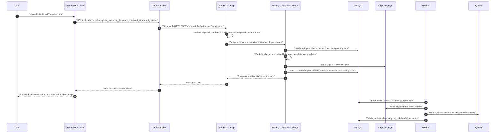
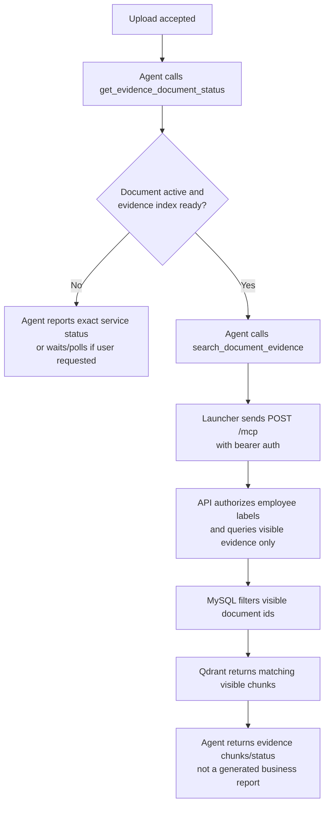

# Enterprise Hub MCP User Flow

Last updated: 2026-07-13

This document describes the current Phase 3 design from a user's natural-language
request to Enterprise Hub MCP tool execution. It is intentionally about request
flow and trust boundaries, not service operations. The same flow applies when
the Enterprise Hub service runs locally or remotely; only the configured base URL
changes.

Related documents:

- [Local MCP endpoint decisions](./mcp-endpoint.md)
- [Local agent test prompts](./local-agent-test.md)
- [API and MCP contract](./api-contract.md)

## Actors And Links



Protocol summary:

| Hop                                 | Protocol / channel                   | Carries credentials?                                      | Notes                                                                   |
| ----------------------------------- | ------------------------------------ | --------------------------------------------------------- | ----------------------------------------------------------------------- |
| User -> Agent                       | Natural language                     | No raw token                                              | The user asks for an Enterprise Hub action, such as uploading a file.   |
| Agent -> Skill                      | Local skill instructions             | No                                                        | The skill tells the agent how to configure and use the launcher.        |
| MCP client -> Launcher              | Local MCP stdio                      | No raw token in configuration                             | The client starts the launcher from MCP config when needed.             |
| Launcher -> Auth issuer             | HTTP                                 | Development login email today; future SSO/OIDC may differ | The launcher keeps the issued token only in process memory.             |
| Launcher -> `POST /mcp`             | Streamable HTTP                      | `Authorization: Bearer <token>`                           | Added by the launcher to every initialize, discovery, and tool request. |
| API `/mcp` -> Existing API behavior | In-process request-scoped delegation | Auth context only                                         | Business authorization remains in the backend API behavior.             |
| Worker -> DB/storage/Qdrant         | Internal service calls               | Service credentials, not agent credentials                | Asynchronous processing is outside the skill/launcher lifecycle.        |

## Cold Start To Upload Request

The user's first prompt may be:

```text
Use Enterprise Hub MCP to upload my xx file.
```

The flow below includes the case where the MCP launcher is not yet configured
and the case where it is already configured but not currently running.



Current Phase 3 nuance: because the launcher stores the development JWT only in
process memory, a fully cold launcher start is normally not logged in yet. The
"already logged in" branch represents an already-running launcher process today,
or a future model-invisible SSO/OIDC token source after Phase 4 authentication
work exists.

## Authenticated Upload Sequence

This sequence starts after the launcher has an employee token. The employee
token can come from today's development email login or from a future SSO/OIDC
flow; the `/mcp` service contract remains bearer authentication per request.



Important boundaries:

- The agent may read the user's selected local file and encode it into the MCP
  tool input.
- The service never dereferences a client `filePath`; it receives explicit inline
  bytes through the MCP contract.
- `/mcp` authenticates every request, including initialization and tool discovery.
- Backend authorization remains authoritative for labels, uploads, queries,
  search visibility, and hidden-resource behavior.
- The skill and launcher do not start the API, worker, database, storage, or
  Qdrant. If the service URL is unreachable, the agent reports that failure.

## Not Logged In Sequence

```mermaid
sequenceDiagram
  autonumber
  participant U as "User"
  participant A as "Agent / MCP client"
  participant L as "MCP launcher"
  participant Auth as "Auth issuer"
  participant D as "MySQL / identity store"
  participant M as "API POST /mcp"

  U->>A: "Upload/search with Enterprise Hub"
  A->>L: "MCP initialize or business tool call over stdio"
  L->>M: "POST /mcp without usable bearer token"
  M-->>L: "EMPLOYEE_AUTH_REQUIRED"
  L-->>A: "Safe login-required result"
  A-->>U: "Ask for registered employee identity or service-approved login step"
  U-->>A: "Provides email today, or completes future SSO/OIDC step"
  A->>L: "enterprise_hub_login_local(email) today"
  L->>Auth: "HTTP login bootstrap"
  Auth->>D: "Verify employee exists and is enabled"
  Auth-->>L: "Employee token and safe employee summary"
  L->>L: "Store token only in process memory"
  L-->>A: "Return safe login status, email, service URL; never token"
  A->>L: "Retry intended MCP business tool"
  L->>M: "POST /mcp with Authorization: Bearer token"
  M-->>L: "Authenticated MCP response"
```

Failure mapping:

| Failure                                  | Visible result                                                      | Agent behavior                                                    |
| ---------------------------------------- | ------------------------------------------------------------------- | ----------------------------------------------------------------- |
| Missing URL                              | Ask for Enterprise Hub base URL                                     | Do not invent a URL.                                              |
| Service unreachable                      | `ENTERPRISE_HUB_UNREACHABLE`                                        | Report connection failure; do not start or repair services.       |
| Missing/expired/restarted launcher token | `EMPLOYEE_AUTH_REQUIRED`                                            | Ask the user to authenticate again.                               |
| Unknown or disabled employee             | Safe authentication failure                                         | Ask the user to verify identity; do not seed or modify employees. |
| Forbidden label/resource                 | Forbidden, not found, or empty result according to backend contract | Do not infer hidden resources exist.                              |

## Search After Upload

Evidence search is a separate authenticated tool call. Upload acceptance does
not guarantee the evidence index is ready.



Structured query after import follows the same launcher and `/mcp`
authentication path, but uses MySQL controlled query behavior instead of Qdrant
evidence retrieval.
