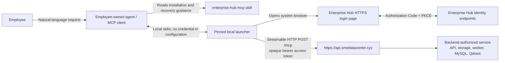

# Enterprise Hub MCP User Flow

> **Official target, pending cutover:** This is the accepted employee flow after the official
> identity, launcher package, and public MCP changes land together. It is not evidence that the
> current Phase 3 development-email/JWT implementation is live for remote users. The historical
> implementation boundary remains in [mcp-endpoint.md](./mcp-endpoint.md).

Last updated: 2026-07-24

This document describes the employee-facing trust boundary, not a service-operations runbook. The
authoritative agent runbook is the dual-homed `enterprise-hub-mcp` skill. The official remote origin
is `https://api.smedatacenter.xyz`; the only approved launcher distribution is
`enterprise-hub-mcp-launcher@0.1.0`.

## Participants And Credential Boundary



| Boundary             | Credential rule                                                                                                                                                                         |
| -------------------- | --------------------------------------------------------------------------------------------------------------------------------------------------------------------------------------- |
| Employee -> agent    | The employee requests an action, but never gives a password, token, authorization code, or credential-store record to the agent.                                                        |
| Agent -> launcher    | The configured local stdio entry contains no secret. The agent may invoke only `enterprise_hub_login`, `enterprise_hub_logout`, and `enterprise_hub_auth_status` for session lifecycle. |
| Launcher -> browser  | The employee enters a password only in the Enterprise Hub HTTPS page. The loopback callback carries a single-use authorization code, never a token.                                     |
| Launcher -> API/MCP  | The launcher alone obtains, refreshes, protects, and attaches opaque bearer access tokens. It stores durable session material only in macOS Keychain or Windows Credential Manager.     |
| MCP -> business data | Every request is authenticated and backend-authorized. The skill/launcher never directly operate API infrastructure, database, Qdrant, storage, Docker, worker, or cloud resources.     |

## Installation Or Update

1. The employee asks their agent to install, update, or repair Enterprise Hub.
2. The agent confirms macOS or Windows, checks current-user Node.js/npm availability, and uses the
   skill-approved exact launcher package in the platform versioned directory.
3. Before modifying the invoking agent's MCP configuration, it inspects and creates a backup.
   It then adds only an `enterprise-hub` **stdio** entry for the pinned launcher and leaves all
   unrelated entries unchanged.
4. Codex uses its supported current configuration mechanism. OpenClaw uses
   `openclaw mcp add`/`set`, then `openclaw mcp doctor enterprise-hub --probe`; it does not use
   direct remote OAuth storage. Other agents use guarded adaptive discovery and stop if their
   safe stdio configuration mechanism cannot be established.
5. The agent runs the launcher's credential-free self-check and reloads/restarts the MCP client as
   needed. It never lets the launcher self-update or installs npm `latest`.

## Login And One-Retry Recovery

```mermaid
sequenceDiagram
  autonumber
  participant E as "Employee"
  participant A as "Agent / MCP client"
  participant L as "Pinned launcher"
  participant B as "System browser"
  participant S as "Enterprise Hub service"

  E->>A: "Upload/search/query Enterprise Hub"
  A->>L: "enterprise_hub_auth_status or business tool"
  alt authentication_required
    A->>L: "enterprise_hub_login"
    L->>B: "Open HTTPS browser login"
    E->>B: "Enter credentials only in browser"
    B->>S: "Authorize code + PKCE request"
    S-->>L: "Code exchange; opaque credentials remain launcher-only"
    L-->>A: "Safe login outcome"
    A->>L: "Retry original business operation once"
  else usable session
    L->>S: "Authenticated POST /mcp"
    S-->>L: "Authorized tool result"
  end
  L-->>A: "Token-free result"
  A-->>E: "Visible status or records"
```

`authentication_required` means the agent calls `enterprise_hub_login`, waits for browser
completion, and retries the original operation once. Browser cancellation, timeout, or failed login
ends that attempt without an automatic browser loop or business-operation retry. `service_unavailable`
means the agent reports the connection failure and does not open a browser or repair service
infrastructure. `forbidden` and not-found results do not prove hidden data exists.

`enterprise_hub_logout` is explicit. It removes the shared current-OS-user local session and asks
the service to revoke it when reachable, which signs out all Enterprise Hub agents sharing that
secure-store record. Removing one agent's MCP entry is not logout; complete uninstall is a separate,
explicitly authorized lifecycle action.

## Business Tool Use

- List labels before uploads and use only returned label keys. Do not supply an organization ID.
- Read only a user-selected or explicitly assigned file's exact bytes. Send an inline file object;
  never send a local file path or reconstruct/normalize content.
- Status polling is allowed only to observe service state. Do not start workers or operate any
  Enterprise Hub service component.
- Reuse a structured-import idempotency key only for exact replay. Treat an import-status 404 as
  not visible or missing, without inferring a hidden batch.
- Treat evidence cursors as opaque same-query continuations. On `INVALID_CURSOR`, restart without
  it. On `CURSOR_EXPIRED`, explain the expiry and restart only if the employee still wants more.
- `enterprise_hub_list_skills` returns directory metadata only. Do not execute an entry, generate a
  report, or turn Enterprise Hub into a direct employee-facing AI service.

## Current Code Boundary

Until cutover, the existing `POST /auth/dev-login`, development JWT issuance, loopback-only `/mcp`,
and `enterprise_hub_login_local`/`enterprise_hub_logout_local` behavior are **pre-cutover current
code**, not official remote instructions. They must be deleted rather than documented as a
compatibility path when the official flow is implemented.
