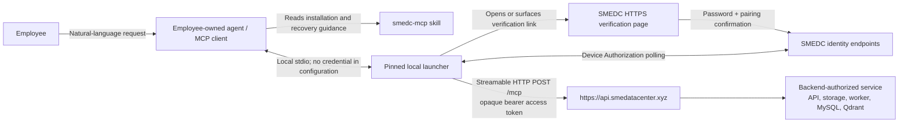
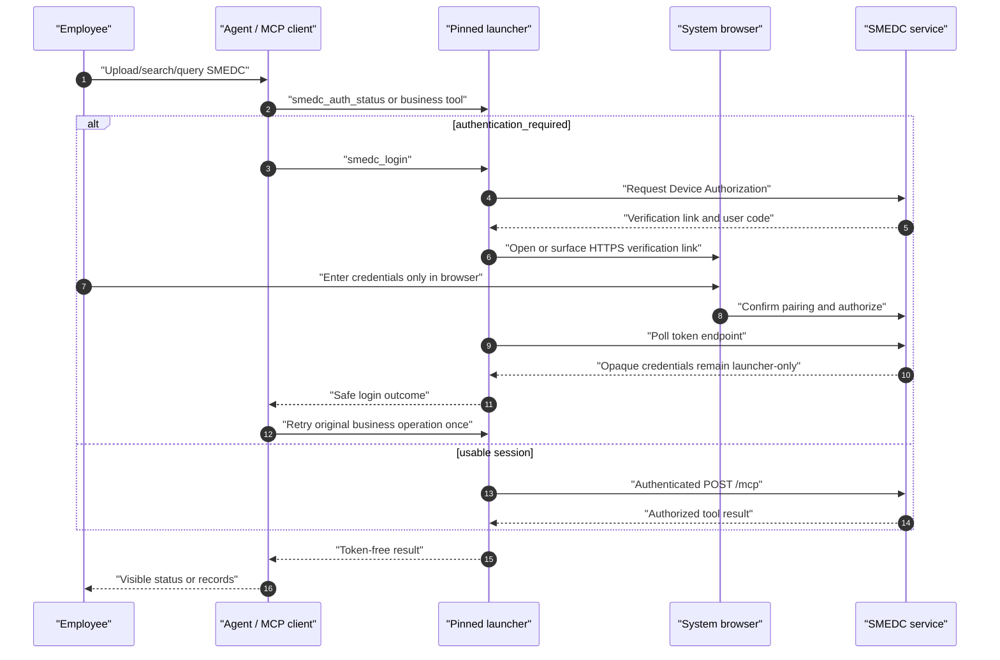

# SMEDC MCP User Flow

Updated: 2026-10-19. Use the published approved `smedc-mcp-launcher@0.12.0` and the dual-homed Skill. Minimum server compatibility remains 0.6.0. Current deployment evidence is in [staging readiness](staging-readiness.md); tenant activation and client acceptance are separate. This is an employee trust-boundary guide, not an operations runbook.

## Upload Authorization

Only active admins upload evidence, structured datasets (including Delivery Ledger), or quarantine
certificates. Upload tools remain visible and marked admin-only. For a known employee role, the
agent must not read or transform the local file; the approved launcher preflights before file access.
Direct HTTP upload endpoints return HTTP `403`. MCP JSON-RPC transport returns HTTP `200`
with `isError: true` in the tool result. Both carry `UPLOAD_ADMIN_REQUIRED`,
`File upload requires the admin role.`, and `retryable: false`: explain the admin requirement
without re-login, retry, or a clearance workaround.
Local prevention produces no backend audit; backend denial best-effort records `file_upload.denied`.
An admin may explicitly classify above their clearance, but ordinary read/status/search/query/download
rules still apply. Partition create/parts/complete require admin; owner abort remains allowed.
The minimum launcher version is 0.6.0 and the source recommended version is 0.12.0; older launchers receive an upgrade error. See the
[endpoint matrix](api-contract.md#file-upload-capability) for surfaces and the future service-identity non-goal.

## Participants And Credential Boundary

| Boundary             | Credential rule                                                                                                                                                                                            |
| -------------------- | ---------------------------------------------------------------------------------------------------------------------------------------------------------------------------------------------------------- |
| Employee -> agent    | The employee requests an action, but never gives a password, token, authorization code, or credential-store record to the agent.                                                                           |
| Agent -> launcher    | The configured local stdio entry contains no secret. The agent may invoke only `smedc_login`, `smedc_logout`, and `smedc_auth_status` for session lifecycle.                                               |
| Launcher -> browser  | The employee enters a password and confirms the agent instance only in the SMEDC HTTPS page; the browser never returns credentials through the agent/model.                                                |
| Launcher -> API/MCP  | The launcher polls the token endpoint, protects and attaches opaque access tokens, and uses Keychain/Credential Manager/a compatible Linux Secret Service when available or memory-only custody otherwise. |
| MCP -> business data | Every request is authenticated and backend-authorized. The skill/launcher never directly operate API infrastructure, database, Qdrant, storage, Docker, worker, or cloud resources.                        |

## Installation Or Update

1. The employee asks their agent to install, update, or repair SMEDC.
2. The agent confirms macOS, Windows, or Linux, checks current-user Node.js/npm availability, and
   uses the skill-approved exact launcher package in the platform versioned directory. Linux uses
   `${XDG_DATA_HOME:-$HOME/.local/share}/SMEDC/launcher/versions/<version>/`, resolved to an
   absolute command path before writing MCP configuration.
3. Before modifying the invoking agent's MCP configuration, it inspects and creates a backup.
   It then adds only an `smedc` **stdio** entry for the pinned launcher and leaves all
   unrelated entries unchanged.
4. Codex uses its supported current configuration mechanism. OpenClaw uses
   `openclaw mcp add`/`set`, then `openclaw mcp doctor smedc --probe`; it does not use
   direct remote OAuth storage. Other agents use guarded adaptive discovery and stop if their
   safe stdio configuration mechanism cannot be established.
5. The agent runs the launcher's credential-free self-check and reloads/restarts the MCP client as
   needed. It never lets the launcher self-update or installs npm `latest`.

## Login And One-Retry Recovery

`authentication_required` means the agent calls `smedc_login`, waits for browser
completion, and retries the original operation once. Browser cancellation, timeout, or failed login
ends that attempt without an automatic browser loop or business-operation retry. `service_unavailable`
means the agent reports the connection failure and does not open a browser or repair service
infrastructure. `forbidden` and not-found results do not prove hidden data exists.

`smedc_logout` is explicit. It asks the service to revoke the current session family when reachable
and removes the local credential. With secure-store custody, agents sharing that OS-user record are
signed out; with memory-only custody, only the current launcher process is affected. Removing one
agent's MCP entry is not logout; complete uninstall is a separate, explicitly authorized lifecycle
action.

## Business Tool Use

- For “which account is logged in?” questions, call zero-input
  `smedc_get_current_user`; return only its display name, email, role, and clearance. Do not infer
  identity from local configuration or accept an employee selector.
- Evidence uploads require an explicit category, complete scopes and file level. Photos require an enterprise and exact store. Enabled fixed categories use the current server category level, which a legacy upload level cannot override. Never infer missing attributes or supply a caller-selected organization.
- Read only a user-selected or explicitly assigned file's exact bytes. Prefer the launcher's
  `file.encoding="path"` input with an absolute local path; use inline base64 only for small files.
  Never reconstruct, normalize, translate, or retype the content.
- Status polling is allowed only to observe service state. Do not start workers or operate any
  SMEDC service component.
- After a text/evidence or structured-table upload returns `202`, keep its Document ID and, for a
  structured upload, ImportBatch ID. Poll the matching status tool after 2 seconds, then 5 seconds,
  then 10 seconds, then every 15 seconds, up to 10 minutes. Report success only at a terminal
  success state; safely summarize `rejected`/`failed` with correction advice. At 10 minutes without
  a terminal result, say still processing with the IDs and how to check later; do not report failure
  or re-upload instead of polling.
- Reuse a structured-import idempotency key only for exact replay. Treat an import-status 404 as
  not visible or missing, without inferring a hidden batch.
- For supported row-query datasets, discover the dataset registry first, send only `canonicalName` field
  values, and use source columns or aliases only to understand the user's wording or label result
  columns.
- `describe_structured_dataset_coverage` reports currently readable applied source windows or
  snapshots/current partitions for one dataset. It is source coverage, not a completeness guarantee or automatic
  answer-quality verdict; the agent decides whether to query, narrow, or ask a clarification.
- Treat evidence cursors as opaque same-query continuations. On `INVALID_CURSOR`, restart without
  it. On `CURSOR_EXPIRED`, explain the expiry and restart only if the employee still wants more.
- `smedc_list_skills` returns directory metadata only. Do not execute an entry, generate a
  report, or turn SMEDC into a direct employee-facing AI service.

## Filtered Partition Download Flow

Range is the default. Bundle mode is optional and requires a known matching ZIP service;
tools/list is insufficient. If ZIP is removed, regenerate saved plans with range downloads.

Use approved launcher 0.12.0 with the matching deployed service. Verify optional ZIP support before selecting bundle mode.
For business/dishes, use the same `enterpriseName`/`storeNameContains` scope in coverage and
prepare. Names are 1–20 NFC/trim literal case-sensitive substrings, OR within the array and AND
with authorization and other selectors. Prepare with compact inclusive `YYYYMMDD` dates and an
exact-replay `idempotencyKey`; poll status with only `requestId` after `retryAfterSeconds`.
Check `isError` and `queued`/`running`/`succeeded`/`failed`/`expired`. Only success may download
with only `requestId`, no selectors; that call does not wait for packaging. Zero success has no
ZIP URL and a valid empty local extract. Failures never imply no data. Keep signed URLs internal,
validate the returned store scope, and release shared scratch only after the last consumer.
Service cleanup is operator-only, including for admins. Exact inputs, limits and errors are in
[api-contract.md](./api-contract.md#filtered-partition-extracts-and-asynchronous-bundles) and the
[core skill](../../skills/smedc-mcp/SKILL.md#optional-partition-bundle-downloads-release-gated).

## Current Release Boundary

Current contracts and defaults are in [API/MCP](api-contract.md) and [official login](official-user-install-and-login.md). MacOS, Windows and Linux installation are supported; a particular host or phone-controlled product requires its own acceptance evidence. Only verified target URLs are handed to administrators.

Business/dishes use partition download for local analysis, not generic row queries. Ledger delivery uses PDFs, not raw ledger rows, aggregates or source downloads. The server's configured daily schedule generates PDFs; employee tools only observe and prepare delivery. Development email/JWT, Authorization Code and loopback callback login paths are absent.

## Store reviews

Published, independently verified launcher `0.12.0` includes `upsert_store_reviews` and
`query_store_reviews`; it is the approved exact installation pin. Confirm the matching service
release and tenant configuration through staging readiness and current permission cards.
Skill refresh does not establish launcher upgrade, service deployment or tenant authorization.
Refresh `get_my_permissions.storeReviewEnterprises` before choosing: writes use write candidates,
queries use read. Validate an explicit enterprise exactly; select/report only a sole unnamed
candidate, ask when multiple exist, report unavailable when none exist. Never infer orgId/defaults.
Current active admins synchronize 1–1000 reviews within 16 MiB UTF-8 JSON per independent
transaction. Ordinary reads require complete category/enterprise/store grants and clearance, even
for admins. Omission preserves values; null clears; scores replace the whole object. Collect pure
ratings but omit them from reply-draft tables. Omit unread replies; save merchantReply only after
platform publication is successful and verified, never from a draft. Beijing time requires an hour;
missing hours or ambiguous identities stay unsynced. Split oversized batches without truncation;
multiple batches have no global rollback. Verify timeouts and distinguish confirmed/unconfirmed
batches before replaying anything that could overwrite new values. Keep filters unchanged with
opaque cursors; restart after data/permission changes. See [review usage](../../skills/smedc-mcp/references/store-reviews.md).
