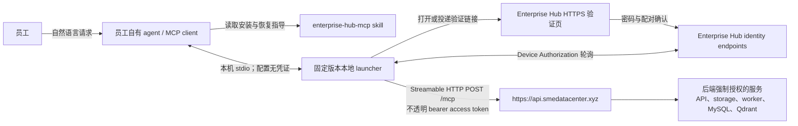
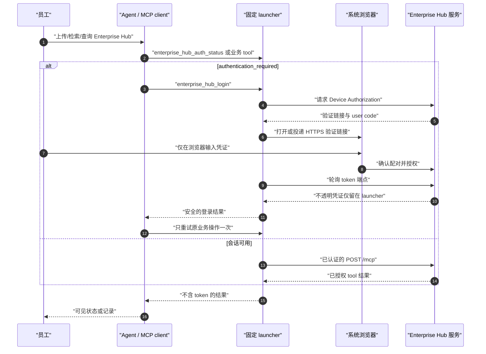

# Enterprise Hub MCP 用户流程

> **正式实现：** 本文描述已经实现的员工流程。固定版本 npm 包
> `enterprise-hub-mcp-launcher@0.2.0` 已发布，正式服务已部署到 staging；原生 macOS/Windows
> 包验收和无头 Linux 闭环已通过，用户可见的 OpenClaw 与支持类 C 手机/浏览器验收仍待补齐。
> 不存在 development login 或 JWT 兼容路径。

最后更新：2026-08-10

本文描述员工侧信任边界，不是服务运维手册。agent 的权威运行手册是双归属的
`enterprise-hub-mcp` skill。正式远程 origin 为 `https://api.smedatacenter.xyz`，唯一批准的
launcher 发行包为 `enterprise-hub-mcp-launcher@0.2.0`。

## 参与者与凭证边界

| 边界                | 凭证规则                                                                                                                       |
| ------------------- | ------------------------------------------------------------------------------------------------------------------------------ |
| 员工 -> agent       | 员工只提出业务请求，绝不向 agent 提供密码、token、授权码或 credential-store record。                                           |
| Agent -> launcher   | 本机 stdio entry 不含秘密。agent 仅用 `enterprise_hub_login`、`enterprise_hub_logout`、`enterprise_hub_auth_status` 管理会话。 |
| Launcher -> browser | 员工只在 Enterprise Hub HTTPS 页面输入密码并确认 agent 实例；浏览器不会通过 agent/model 返回任何凭证。                         |
| Launcher -> API/MCP | launcher 轮询 token 端点、保护并附加不透明 access token；桌面使用 Keychain/Credential Manager，真正无头主机只保存在内存。      |
| MCP -> 业务数据     | 每个请求均经认证与后端授权。skill/launcher 绝不直接操作 API 基础设施、数据库、Qdrant、storage、Docker、worker 或云资源。       |

## 安装或更新

1. 员工用自然语言要求 agent 安装、更新或修复 Enterprise Hub。
2. agent 确认 macOS 或 Windows，检查当前用户的 Node.js/npm，然后把 skill 批准的精确 launcher
   包安装到该平台版本目录。
3. 修改调用该 agent 的 MCP 配置前，先检查并备份；随后只添加一个固定 launcher 的
   `enterprise-hub` **stdio** entry，保留所有无关 entries。
4. Codex 使用当前版本支持的配置机制。OpenClaw 使用 `openclaw mcp add`/`set`，随后执行
   `openclaw mcp doctor enterprise-hub --probe`；不能使用直连远程 OAuth store。其他 agent 进行
   受保护的自适应发现，无法确定安全 stdio 配置方式时停止并报告阻塞。
5. agent 运行 launcher 的无凭证自检，并按需 reload/restart MCP client。不得让 launcher 自更新，
   也不得安装 npm `latest`。

## 登录与一次重试恢复

`authentication_required` 表示 agent 调用 `enterprise_hub_login`、等待浏览器完成，再只重试原操作
一次。浏览器取消、超时或登录失败会结束本次尝试，不得自动循环打开浏览器或重试业务操作。
`service_unavailable` 表示报告连接失败，不打开浏览器也不修复服务基础设施。`forbidden` 或 not-found
不证明隐藏数据存在。

`enterprise_hub_logout` 必须显式调用。它删除当前 OS 用户共享的本机会话，并在可达时请求服务端
撤销，从而让共享同一安全存储记录的全部 Enterprise Hub agent 退出。移除一个 agent 的 MCP entry
不是退出登录；完全卸载是另一个需要明确授权的生命周期动作。

## 业务 Tool 使用

- 上传前列出标签，只使用返回的 label key；不得传入 organization ID。
- 只读取用户选择或明确指定文件的精确字节。优先使用 launcher 的 `file.encoding="path"` 和绝对
  本地路径；仅对小文件使用 inline base64。不得重建、规范化、翻译或重输内容。
- 只能轮询服务状态；不得启动 worker 或操作任何 Enterprise Hub 服务组件。
- 文本/证据或结构化表格上传返回 `202` 后，保留 Document ID；结构化上传还保留 ImportBatch ID。按
  2 秒、5 秒、10 秒、之后每 15 秒的节奏轮询对应 status tool，默认最多 10 分钟。只有到达成功终态才可
  告知上传成功；`rejected`/`failed` 只总结安全返回的错误并给出修改建议。10 分钟仍未终态时报告仍在
  处理中、附带 IDs 和稍后查询方式；不得报告失败，也不得用重新上传替代轮询。
- 只有精确重放时复用 structured-import idempotency key。import-status 404 只能理解为不可见或不存在，
  不得推断隐藏 batch。
- evidence cursor 是不透明的同 query continuation。`INVALID_CURSOR` 时不带 cursor 重新开始；
  `CURSOR_EXPIRED` 时说明过期，只有员工仍想继续时才重新开始。
- `enterprise_hub_list_skills` 只返回目录元数据。不得执行条目、生成报告，或把 Enterprise Hub 变成
  员工直接对话的 AI 服务。

## 当前发布边界

代码已经实现 OAuth Device Authorization、不透明 access token、轮换 durable credential、桌面
安全存储与无头内存态保管、公开 HTTPS `/mcp` 和固定版本 launcher。staging migration、正式
session fixture smoke、原生 macOS/Windows 包验收和无头 Linux 登录到业务工具闭环已通过；用户
可见的 OpenClaw 与支持类 C 手机/浏览器验收仍待补齐。Authorization Code + PKCE 仅为服务端
minimum-compatible 0.1.x 路径；已删除的 `/auth/dev-login`、JWT 和本地邮箱登录工具必须持续保持不存在。
