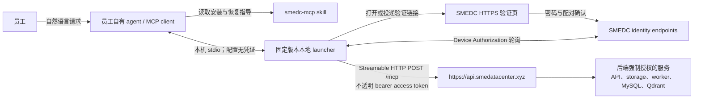
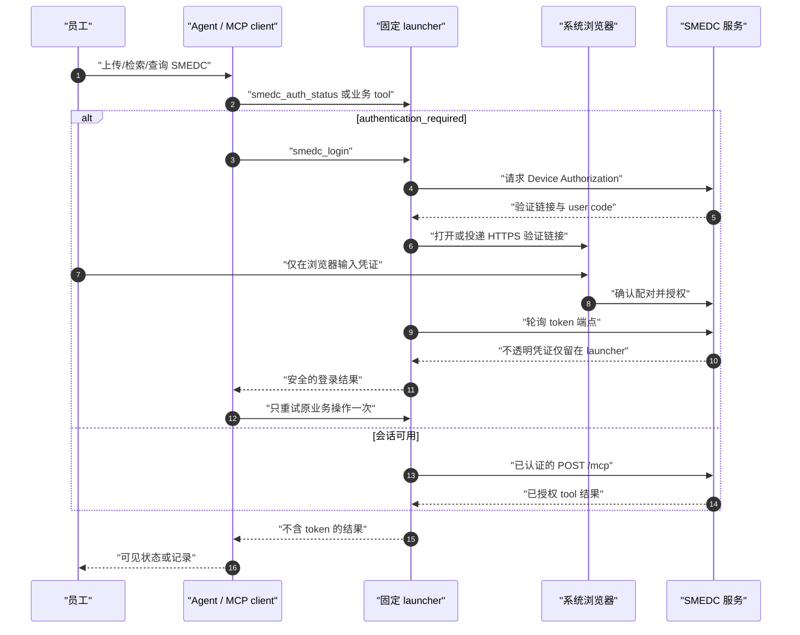

# SMEDC MCP 用户流程

更新：2026-10-19。安装已发布的 `smedc-mcp-launcher@0.12.0`，服务端源码最低版本为 0.12.0。已核实线上推荐 0.12.0、最低 0.6.0；源码最低版本变更待合并与部署。以双归属基础 Skill 为安装手册；部署证据见 [staging 状态](staging-readiness.md)，企业激活与特定宿主验收分别核对。本文不是运维手册。

## 上传权限

仅启用的 `admin` 可上传证据文档、结构化数据（含进货台账 Delivery Ledger）和检疫证明。
上传工具保持静态可见并标为仅管理员可用；已知为 `employee` 时，agent 不得读取或转换本地文件。
批准版本 launcher 在文件访问前检查身份。直接 HTTP 上传端点返回 HTTP `403`；
MCP JSON-RPC 传输返回 HTTP `200`，工具结果包含 `isError: true`。两者均携带 `UPLOAD_ADMIN_REQUIRED`、
`File upload requires the admin role.`、`retryable: false`。解释管理员要求即可，不重登、不重试，
不通过提高 clearance 绕过。仅本地阻止不产生后端审计；后端拒绝尽力记录 `file_upload.denied`。
管理员可明确声明高于自身 clearance 的密级，但普通状态、清单、检索、查询和下载仍遵循原有读取规则。
分片 create/parts/complete 要求管理员，原上传所有者仍可 abort。源码 OAuth 签发及刷新要求至少
0.12.0；更旧的 launcher 会收到升级要求。完整入口矩阵和未来服务身份的独立设计边界见
[API 契约](api-contract.md#file-upload-capability)。

## 参与者与凭证边界

| 边界                | 凭证规则                                                                                                                                                                |
| ------------------- | ----------------------------------------------------------------------------------------------------------------------------------------------------------------------- |
| 员工 -> agent       | 员工只提出业务请求，绝不向 agent 提供密码、token、授权码或 credential-store record。                                                                                    |
| Agent -> launcher   | 本机 stdio entry 不含秘密。agent 仅用 `smedc_login`、`smedc_logout`、`smedc_auth_status` 管理会话。                                                                     |
| Launcher -> browser | 员工只在 SMEDC HTTPS 页面输入密码并确认 agent 实例；浏览器不会通过 agent/model 返回任何凭证。                                                                           |
| Launcher -> API/MCP | launcher 轮询 token 端点、保护并附加不透明 access token；有可用安全存储时使用 Keychain/Credential Manager/兼容的 Linux Secret Service，否则只保存在 launcher 进程内存。 |
| MCP -> 业务数据     | 每个请求均经认证与后端授权。skill/launcher 绝不直接操作 API 基础设施、数据库、Qdrant、storage、Docker、worker 或云资源。                                                |

## 安装或更新

1. 员工用自然语言要求 agent 安装、更新或修复 SMEDC。
2. agent 确认 macOS、Windows 或 Linux，检查当前用户的 Node.js/npm，然后把 skill 批准的精确
   launcher 包安装到该平台版本目录。Linux 使用
   `${XDG_DATA_HOME:-$HOME/.local/share}/SMEDC/launcher/versions/<version>/`，写入 MCP
   配置前必须解析为绝对 command 路径。
3. 修改调用该 agent 的 MCP 配置前，先检查并备份；随后只添加一个固定 launcher 的
   `smedc` **stdio** entry，保留所有无关 entries。
4. Codex 使用当前版本支持的配置机制。OpenClaw 使用 `openclaw mcp add`/`set`，随后执行
   `openclaw mcp doctor smedc --probe`；不能使用直连远程 OAuth store。其他 agent 进行
   受保护的自适应发现，无法确定安全 stdio 配置方式时停止并报告阻塞。
5. agent 运行 launcher 的无凭证自检，并按需 reload/restart MCP client。不得让 launcher 自更新，
   也不得安装 npm `latest`。

## 登录与一次重试恢复

`authentication_required` 表示 agent 调用 `smedc_login`、等待浏览器完成，再只重试原操作
一次。浏览器取消、超时或登录失败会结束本次尝试，不得自动循环打开浏览器或重试业务操作。
`service_unavailable` 表示报告连接失败，不打开浏览器也不修复服务基础设施。`forbidden` 或 not-found
不证明隐藏数据存在。

`smedc_logout` 必须显式调用。它在可达时请求服务端撤销当前 session family，并删除本地
凭证。使用安全存储时，共享该 OS-user record 的 agent 一起退出；使用仅内存会话时，只影响当前
launcher 进程。移除一个 agent 的 MCP entry 不是退出登录；完全卸载是另一个需要明确授权的生命周期动作。

## 业务 Tool 使用

- 员工询问“当前登录的是哪个账号”时，零参数调用 `smedc_get_current_user`，只返回其
  display name、email、role 和 clearance；不得从本机配置推断身份，也不得接受 employee selector。
- Evidence 上传必须明确类别、完整 scopes 和逐文件密级；照片明确企业及一家精确门店。启用业务授权后，固定类别使用当前服务配置密级，旧上传 level 不能覆盖；不从内容或名称推断缺失属性，不任意指定组织。
- 只读取用户选择或明确指定文件的精确字节。优先使用 launcher 的 `file.encoding="path"` 和绝对
  本地路径；仅对小文件使用 inline base64。不得重建、规范化、翻译或重输内容。
- 只能轮询服务状态；不得启动 worker 或操作任何 SMEDC 服务组件。
- 文本/证据或结构化表格上传返回 `202` 后，保留 Document ID；结构化上传还保留 ImportBatch ID。按
  2 秒、5 秒、10 秒、之后每 15 秒的节奏轮询对应 status tool，默认最多 10 分钟。只有到达成功终态才可
  告知上传成功；`rejected`/`failed` 只总结安全返回的错误并给出修改建议。10 分钟仍未终态时报告仍在
  处理中、附带 IDs 和稍后查询方式；不得报告失败，也不得用重新上传替代轮询。
- 只有精确重放时复用 structured-import idempotency key。import-status 404 只能理解为不可见或不存在，
  不得推断隐藏 batch。
- 支持逐行查询的数据集先发现 dataset registry，只发送 `canonicalName` 字段；`sourceColumn` 和 aliases 只用于
  理解员工措辞或展示结果表头。
- `describe_structured_dataset_coverage` 只报告当前员工可读取的已应用 source window 或 snapshot。
  它不是完整性保证，也不会自动判断查询答案是否充分；agent 需要自行决定查询、收窄范围或追问。
- evidence cursor 是不透明的同 query continuation。`INVALID_CURSOR` 时不带 cursor 重新开始；
  `CURSOR_EXPIRED` 时说明过期，只有员工仍想继续时才重新开始。
- `smedc_list_skills` 只返回目录元数据。不得执行条目、生成报告，或把 SMEDC 变成
  员工直接对话的 AI 服务。

## 门店过滤与异步分区下载

Range is the default. Bundle mode is optional and requires a known matching ZIP service;
tools/list is insufficient. If ZIP is removed, regenerate saved plans with range downloads.

使用批准的 launcher 0.12.0 及匹配服务；选择可选 ZIP 前仍须确认目标服务可用。
business/dishes 的 coverage 与 prepare 使用相同 `enterpriseName`/`storeNameContains` 范围。
后者为 1–20 个 NFC/trim、每项 1–255 字符的字面、区分大小写子串；数组内 OR，与授权及其他条件 AND。
prepare 使用含首尾日期的 `YYYYMMDD` 和仅精确重放复用的 `idempotencyKey`；按 `retryAfterSeconds`
等待后，仅用 `requestId` 查询 status。检查 `isError` 及 queued/running/succeeded/failed/expired；
仅 succeeded 后才仅用 `requestId` 下载，不能混合任何选择器，下载调用不会等待打包。
零分区成功没有 ZIP URL，但产生有效空本地 extract；失败不能当成无数据。签名链接留在 Launcher 内部，
校验返回门店范围，共享临时目录等最后消费者释放。服务数据清理只属于操作员，不属于员工 MCP（含 admin）。
精确参数、限额和错误处理参见 [API 契约](./api-contract.md#filtered-partition-extracts-and-asynchronous-bundles)
和 [基础 Skill](../../skills/smedc-mcp/SKILL.md#optional-partition-bundle-downloads-release-gated)。

## 当前发布边界

当前合同与默认值见 [API/MCP](api-contract.md) 和 [正式登录](official-user-install-and-login.md)。macOS、Windows、Linux 支持安装；特定宿主和手机遥控产品需各自验收。只向管理员交付经过核对的目标企业入口。

经营/菜品通过分区下载后本地分析，不提供通用行查询。员工台账交付只使用 PDF，不开放原始行、汇总或原件。PDF 按服务配置的每日时刻生成，员工工具只查询和准备交付。开发邮箱/JWT、Authorization Code 和 loopback 回调登录路径均不存在。

## 店铺评价

已发布并独立验证的 launcher `0.12.0` 包含 `upsert_store_reviews` / `query_store_reviews`，是当前批准安装 pin；仍须核对匹配服务部署与企业类别/授权配置。Skill 更新不代表 launcher 升级、部署或租户授权。
先刷新 `get_my_permissions.storeReviewEnterprises`，写入用 write、查询用 read：明确企业先精确校验；未指定且仅一个候选时填入并告知，多个先问，零个报告不可用。禁止推断 orgId 或默认企业。
当前有效 admin 可按 1–1000 条及 16 MiB UTF-8 JSON 预算同步，每批独立事务；读需完整类别/企业/门店授权与密级，admin 不绕过。正文/评分/回复省略不更新、null 清空，评分整体替换；纯评分也入库但不进入拟回复表。未读到的回复省略，只有平台发布成功且核验后才补写 merchantReply，草稿不入库。
北京时间至少到小时，缺小时或身份歧义记未同步；超限分批不截断，多批不承诺全局回滚。超时先核验，分别报告确认与未确认批次，不自动重放可能覆盖新值的旧数据。查询用不透明游标且保持筛选不变，权限或数据变化后重启。详见[评价使用规则](../../skills/smedc-mcp/references/store-reviews.md)。
