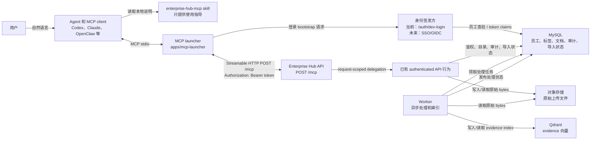
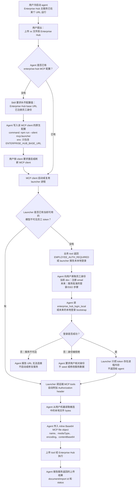
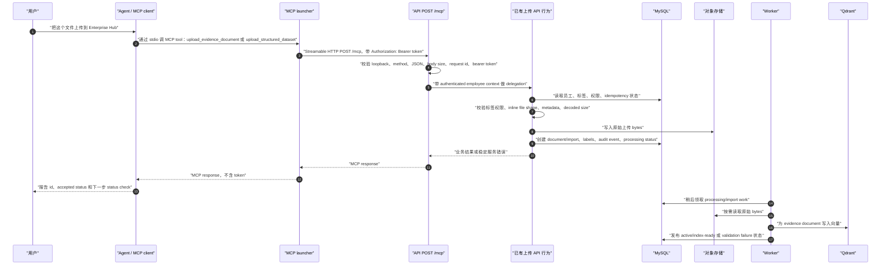
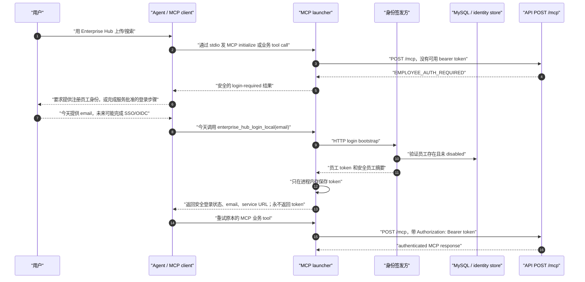
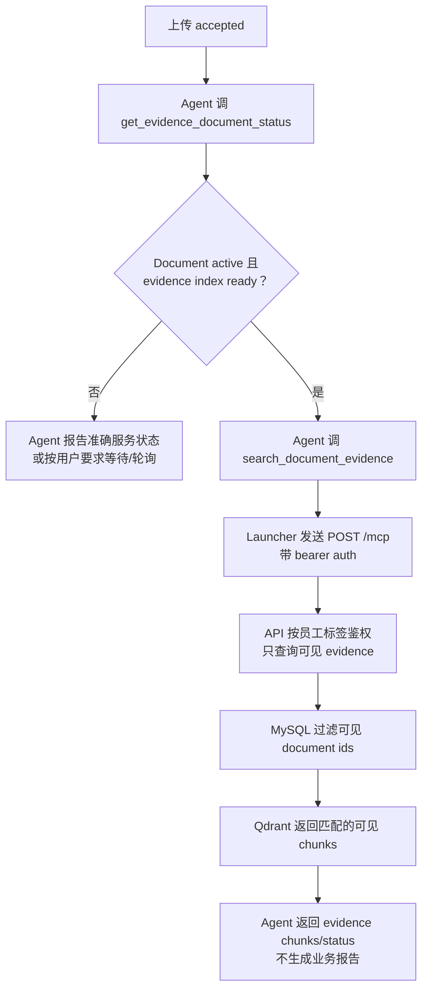

# Enterprise Hub MCP 用户流程

最后更新：2026-07-13

本文描述当前 Phase 3 设计里，用户从自然语言请求到 Enterprise Hub MCP
工具执行之间的流转。它是流程和边界说明，不是服务运维手册。主服务运行在本地
还是远端没有本质区别；差别只是 MCP launcher 配置的 Enterprise Hub base URL。

相关文档：

- [本地 MCP endpoint 设计决策](./mcp-endpoint.md)
- [本地 agent 人工测试](./local-agent-test.md)
- [API 和 MCP contract](./api-contract.md)

## 参与者和链路



协议摘要：

| 链路                        | 协议 / 通道                      | 是否携带凭证                          | 说明                                                        |
| --------------------------- | -------------------------------- | ------------------------------------- | ----------------------------------------------------------- |
| 用户 -> Agent               | 自然语言                         | 不携带 raw token                      | 用户说“上传文件”等任务。                                    |
| Agent -> Skill              | 本地 skill 指令                  | 不携带                                | skill 告诉 agent 如何配置和使用 launcher。                  |
| MCP client -> Launcher      | 本机 MCP stdio                   | 配置中不写 raw token                  | MCP client 根据配置启动 launcher。                          |
| Launcher -> 身份签发方      | HTTP                             | 当前是开发 email；未来可能是 SSO/OIDC | launcher 只把签发的 token 保存在进程内存里。                |
| Launcher -> `POST /mcp`     | Streamable HTTP                  | `Authorization: Bearer <token>`       | launcher 给 initialize、工具发现、工具调用都自动加 header。 |
| API `/mcp` -> 已有 API 行为 | 进程内 request-scoped delegation | 只传 auth context                     | 业务鉴权仍由后端 API 行为负责。                             |
| Worker -> DB/storage/Qdrant | 内部服务调用                     | 服务自身凭证，不是 agent 凭证         | 异步处理不属于 skill/launcher 生命周期。                    |

## 冷启动到上传请求

用户第一句话可能是：

```text
给我上传 xx 文件到 Enterprise Hub。
```

下面的流程同时覆盖两种情况：MCP launcher 还没有配置，以及已经配置但当前还没运行。



当前 Phase 3 的细节：launcher 只把 development JWT 保存在进程内存里，所以真正冷启动
launcher 时通常还没有登录。上图“已经登录”的分支，在今天代表一个已经运行且还持有
token 的 launcher 进程；在未来 Phase 4 之后，也可以代表模型不可见的 SSO/OIDC token
来源。

## 已登录上传时序

以下时序从 launcher 已有员工 token 开始。token 可以来自今天的开发 email 登录，也可以来自
未来的 SSO/OIDC；`/mcp` 服务契约仍然是每个请求都用 bearer auth。



关键边界：

- Agent 可以读取用户选择的本地文件，并把它编码为 MCP tool input。
- 服务端永远不 dereference 客户端 `filePath`；它只接收 MCP contract 中明确传入的
  inline bytes。
- `/mcp` 对每个请求都鉴权，包括 initialize 和工具发现。
- 标签、上传、查询、搜索可见性、隐藏资源行为都以后端鉴权为准。
- Skill 和 launcher 不启动 API、worker、数据库、storage 或 Qdrant。服务 URL 不可达时，
  agent 只报告连接失败。

## 未登录时序



失败映射：

| 失败                            | 可见结果                                           | Agent 行为                             |
| ------------------------------- | -------------------------------------------------- | -------------------------------------- |
| 缺少 URL                        | 询问 Enterprise Hub base URL                       | 不发明 URL。                           |
| 服务不可达                      | `ENTERPRISE_HUB_UNREACHABLE`                       | 报告连接失败；不启动或修复服务。       |
| token 缺失、过期、launcher 重启 | `EMPLOYEE_AUTH_REQUIRED`                           | 要求用户重新认证。                     |
| 员工不存在或 disabled           | 安全的鉴权失败                                     | 要求用户核对身份；不 seed 或修改员工。 |
| 标签/资源无权限                 | 按后端 contract 返回 forbidden、not found 或空结果 | 不推断隐藏资源存在。                   |

## 上传后的搜索

Evidence search 是独立的 authenticated tool call。上传 accepted 不等于 evidence index 已经 ready。



Structured query after import 使用同一条 launcher 和 `/mcp` 鉴权链路，但后端执行的是受控
MySQL structured query，而不是 Qdrant evidence retrieval。
