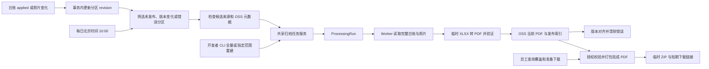

# 台账 PDF 归档、更新与交付设计

原设计日期：2026-10-04；核对更新：2026-10-05。状态：已实施、发布并完成授权企业的首次回填；每日更新标记筛选已上线，线上巡检时间已调整为北京时间 10:00。

实现基线：`main@1a03b74bd827`（服务 PR #204、#207、#208、#209 及发布同步已合并）。时间调整是持久化运行配置，通过正式部署 `37280340186` 生效；代码默认时间仍为 03:00，不应把默认值误写成当前线上时间。本文件记录当前设计，实施结果见[实施计划与完成状态](../plans/2026-10-04-ledger-pdf-archive.md)。

## 1. 已确认的需求与边界

- 归档单位为 `orgId + store_name + purchase_date`，沿用精确门店名称，不新增门店 ID 或门店主数据体系。日期来自原始单据“收货日期”，不是上传日期或单号日期。
- 台账导入 applied、补单或检疫照片变化只标记受影响分区；服务每日巡检筛选标记并提交生成任务。同一分区一天内多次变化合并处理。员工 MCP/HTTP（包括管理员）不提供生成入口。
- 每次生成读取门店当天全部有效台账，替换当前 PDF；不提供用户可选的历史 PDF。正文使用 `food-purchase-ledger-cn-v2` 的 11 列，检疫照片附于正文后并标注收货单号。无照片不提示，无台账不生成空白 PDF。
- XLSX 仅为转换中间文件，不新增 OSS 归档或下载入口。原始源文件保留内部溯源，不因 PDF 迁移删除。
- 用户按门店、日期区间或离散日期获取现成 PDF，单份和多份统一组成 ZIP。准备 ZIP、查询状态和领取链接不触发 PDF 生成。
- 交付开关开启后，关闭对外台账明细和原始台账文件签发，保留受控汇总。内部任务仍能读取数据库；其他 dataset 不受影响。
- 不新增修改既有收货单能力；同单号不同内容仍返回 `RECEIPT_ID_CONFLICT`。
- 供应商普通内容更新不刷新历史 PDF；实际重新生成时采用当时目录。来源归档或权限撤销仍影响旧产物可读性。
- 开发者 CLI 保留指定门店/日期、全企业历史检查与重建能力，负责首次回填以及无标记历史缺失、漏标记等恢复；不依赖员工 Agent 或浏览器登录。
- 服务保持确定性数据基础设施的定位，不运行 Skill、不理解自然语言、不新增 AI 分析或通用报表编排。

## 2. 当前实现依据

| 能力                           | 主要代码                                                                           |
| ------------------------------ | ---------------------------------------------------------------------------------- |
| 分区、请求、来源和巡检目标模型 | `packages/db/prisma/schema.prisma`                                                 |
| 范围、路径、幂等提交与分页枚举 | `packages/ledger-archive/src/scope.ts`、`keys.ts`、`service.ts`、`repository.ts`   |
| 完整快照、供应商取值与变更标记 | `packages/ledger-archive/src/source-reader.ts`、`supplier-values.ts`、`changes.ts` |
| 来源授权与发布 fencing         | `packages/ledger-archive/src/access.ts`、`publication.ts`                          |
| 候选筛选、持久巡检与修复统计   | `packages/ledger-archive/src/reconciliation.ts`                                    |
| PDF 转换、生成、ZIP 与维护调度 | `apps/worker/src/ledger-pdf/`                                                      |
| 四个公共 HTTP/MCP 下载工具     | `apps/api/src/routes/ledger-pdfs.ts`、`packages/mcp-contract/src/index.ts`         |
| 开发侧全量检查及重建           | `scripts/ledger-pdf.ts`、`scripts/ledger-pdf-support.ts`                           |

## 3. 整体流程

生成由每日服务任务和开发者 CLI 共用内部归档服务，worker 负责转换与发布；公共获取请求只打包已有 PDF。



## 4. 分区、状态与发布

### 4.1 存储路径

逻辑目录固定为 `ledger_records`；部署的 OSS prefix 由存储配置添加：

```text
org/<orgId>/ledger_records/<门店>/<YYYY>/<MM>/<DD>/台账_<generation>-<attemptId>.pdf
org/<orgId>/ledger_bundles/<requestId>/<attempt>-<随机标识>.zip
```

实际 worker 候选键包含 generation 与 attempt ID，防止失效租约或迟到上传覆盖其他任务。路径段可逆转义 `%`、斜杠、反斜杠、控制字符及 `.`/`..`，中文保留；键长连同 prefix 在提交前校验。门店 hash 仅用于索引，并回查精确原名，不成为门店 ID。

下载文件名为 `食品经营单位进货台帐_<门店>_<YYYY-MM-DD>.pdf`。current 指针只指向一个已发布对象；替换和垃圾回收期间可能暂存旧对象，不提供历史版本接口。

### 4.2 持久模型

- `LedgerPdfPartition` 保存企业、精确门店、门店 hash、日期、源 revision、请求/发布 generation、发布 revision/指纹、current key、摘要、大小、行/照片计数、密级、模板版本、生成时间和错误。唯一键为 `(orgId, storeNameHash, purchaseDate)`。
- `LedgerArtifactRequest` 保存 refresh/download 类型、企业、employee/operator/system_reconciler actor、幂等键、参数指纹、范围、状态及 ZIP 有效期。
- `LedgerArtifactRequestItem` 保存目标分区、generation、处理任务及逐项结果；请求状态为 queued/running/succeeded/partial_failed/failed，单项还支持 empty/superseded。
- `LedgerPdfSource` 保存当前 PDF 实际依赖的台账、供应商和检疫来源及密级，不复制业务行或图片。
- `LedgerPdfReconciliationRun` 保存企业、北京时间 scheduleDate、阶段、游标、计数和错误；唯一键 `(orgId, scheduleDate)`。`LedgerPdfReconciliationTarget` 关联本次巡检实际提交或复用的修复项，使修复统计不被后续无关任务覆盖。
- `ProcessingRun` 使用 `ledger_pdf_generate`、`ledger_pdf_bundle`、`ledger_pdf_reconcile`，复用租约、心跳和重试；`StorageGarbage` 记录确切待清理对象键。

派生 PDF 不伪装成上传 Document。current 状态查询无需枚举 OSS bucket。

### 4.3 变化与生成时序

1. 台账 applied、照片上传/归档及影响可读性的源文档归档，在对应事务中更新受影响分区 revision。服务返回 `affectedLedgerPartitions`；幂等上传回放不无故递增。照片先于台账上传时，后续 applied 将其纳入快照。
2. 每日服务任务筛选候选；CLI 可以主动重建选定范围。内部请求为目标分配单调 generation，同幂等键同参数复用请求，异参冲突。
3. Worker 在短快照中读取完整有效台账、供应商信息、检疫引用和 revision；事务外获取经校验的照片并渲染。读源不按某个触发员工的 clearance 截断。
4. 候选对象先登记受租约保护的垃圾记录，再上传并核验。发布短事务校验 lease、generation、revision 和来源有效性；源变化使当前 generation 有界重试读取新快照，较新 generation 已取代它时记录 superseded。
5. 成功发布切换 current，保存发布 revision/指纹及实际来源，清除错误，旧对象同事务登记垃圾回收。失败保留旧 current；数据已变时旧 PDF 不作为最新交付。
6. 有效台账为零时发布 empty、撤销 current，不生成空白 PDF，不删除源单据或照片。纯主动重绘失败且源和对象仍有效时，旧 PDF 可继续使用。

供应商普通内容不参与更新标记或源指纹，不自动刷新历史 PDF；实际使用的供应商源仍纳入下载授权。显式归档或权限撤销不能沿派生 PDF 绕过。

### 4.4 每日巡检与全量恢复的分工

**调度。** 当前线上 `LEDGER_PDF_RECONCILE_TIME=10:00`，固定 `Asia/Shanghai`；代码及 `.env.example` 默认仍为 03:00。巡检开关默认关闭，正式切换后开启。Worker 启动及每分钟维护检查到期，数据库去重，不依赖 Codex、员工 Agent 或开发电脑在线。停机恢复补做最近到期任务，先续跑未结束扫描，不为每个遗漏日期叠加任务。

**候选筛选。** 日常任务只分页读取 `ledger_pdf_partitions` 中以下条件的并集：

```text
publishedDataRevision IS NULL
OR publishedDataRevision <> dataRevision
OR errorCode IS NOT NULL
```

复用现有 revision/错误字段，不新增光标服务或标记表。只对候选读取来源指纹和 OSS HEAD，再根据最新状态提交或复用修复任务。健康已发布分区不读来源、不发 HEAD、不渲染；一次最终候选页即可结束扫描，旧阶段/游标格式保留兼容续跑。

成功发布后版本对齐且错误清除，该分区不再入选；empty 同样对齐。失败和渲染期间的新源变化保留待处理状态。扫描经过某个键后发生的新变更，若未被当前任务处理，将在后续每日任务入选，不承诺实时生成。

| 场景                                      | 每日标记巡检           | 开发者 CLI 全量检查/重建           |
| ----------------------------------------- | ---------------------- | ---------------------------------- |
| 新分区未发布、源 revision 变化或错误      | 入选后检查并修复       | 可检查并重建                       |
| 候选的源指纹、OSS 存在性或元数据异常      | 检查并修复             | 可检查并重建                       |
| 健康索引无标记，但 OSS 丢失或源变更漏标记 | 不进行逐分区检查       | 从事实和索引并集发现并修复         |
| 历史台账完全没有索引                      | 不通过日常候选筛选发现 | 枚举事实后补齐                     |
| 已无有效台账的 dirty 索引                 | 发布 empty             | 全量枚举后按 empty 处理            |
| 最新生成任务在途且可恢复                  | 复用并记录，不重复投递 | 保持现有任务幂等和 generation 规则 |

每页最多 200 个候选，HEAD 并发 4；持久化 cursor/计数，页间让出 worker。修复低于普通导入任务优先级，复用渲染并发限制。分区锁内重查状态避免并发重复提交；扫描结束与修复完成分别返回 `scanCompleted`、`repairsCompleted`，结合 pending/failed/superseded/repaired 计数判断结果。

HEAD 只检查存在性、大小和保存的 SHA-256 元数据，不下载 PDF、不扫 bucket。缺少规定摘要视为异常；403、超时和限流是检查失败，不当成 404。该流程不是字节级完整性审计，不删除陌生对象或业务源数据。

## 5. PDF 内容与运行环境

- 正文固定 11 列及中文标题，附门店、日期和页码；内部 ID 不进入正文。行按单号、工作表、行号及稳定来源键排序，保留合法重复明细。
- 单号、电话、日期、批号以文本处理，内部数量金额使用精确十进制字符串；缺失、null 和历史字面量 null 留空。
- A4 横向、重复表头、换行和分页。长字段通过续行保留内容；照片按单号、上传时间和稳定来源排序，每张一个附页、按单据编号、处理方向且等比不裁切。
- Worker 用 ExcelJS 写临时工作簿，经 LibreOffice Calc headless 转 PDF，并用 Poppler 验证可解析性/页数；Sharp 处理照片。仅 worker 包含渲染依赖，API/release-ops 不安装 Office。
- 每任务独立目录和 Office profile，参数数组调用子进程，超时/信号终止进程组；非 root 运行，只转换服务生成的工作簿，文本不作为公式/宏/外链执行。
- 单分区限制：10,000 行、200 张照片、500 MiB 输入照片、200 MiB PDF、180 秒转换；默认单 worker 进程渲染并发 1。超限失败，不截断。临时文件清理和崩溃残留回收受 lease 约束。
- 真实合成中文、长字段、多页和照片样例由 worker AMD64 镜像检查覆盖。依赖风险按仓库当前审计策略报告；`config/dependency-risk-acceptance.json` 当前 exceptions/moderates 均为空，本设计不新增豁免或另设审计门禁。

## 6. API、MCP 与权限

### 6.1 当前四个公开入口

| HTTP                                                    | MCP                             | 职责                                      |
| ------------------------------------------------------- | ------------------------------- | ----------------------------------------- |
| `POST /v1/ledger-pdfs/coverage`                         | `describe_ledger_pdf_coverage`  | 授权门店逐日状态，storeNames 可省略，分页 |
| `GET /v1/ledger-pdfs/requests/:requestId`               | `get_ledger_pdf_request_status` | 请求状态、分页结果和安全错误              |
| `POST /v1/ledger-pdfs/downloads`                        | `prepare_ledger_pdf_download`   | 幂等打包现成 PDF，202/requestId 后轮询    |
| `POST /v1/ledger-pdfs/requests/:requestId/download-url` | `get_ledger_pdf_download_url`   | 完成后重新鉴权并签发短期 ZIP 链接         |

不存在公共 `POST /v1/ledger-pdfs/refresh` 或 `refresh_ledger_pdfs`。内部 refresh 服务仍供 CLI 和每日任务使用。

日期为真实日历 `YYYY-MM-DD`，范围首尾包含；离散日期与 startDate/endDate 互斥。显式门店精确匹配，不接受公共 orgId。下载请求最多 50 店、366 天、5,000 实际分区；coverage 同样约束日期/实际分区并每页 200。开发者内部全量分页枚举不受公共范围上限限制。

### 6.2 权限

企业取自认证上下文，所有非 health 公共接口后端鉴权。完整日 PDF 密级取实际台账、供应商和检疫来源最大值；读取要求当前员工对全部来源均有权，不生成按员工 clearance 截断的副本。

Coverage、状态和计数过滤当前不可读分区；不可见范围返回 unavailable，不泄露存在性。公开状态拒绝内部 operator/system 请求；下载请求绑定请求者，管理员不能凭 requestId 接管其他员工下载。打包和发链接均重新检查账号、企业、密级、来源与当前产物。

已签发 URL 短期有效，来源撤销不承诺即时撤回已下载文件或既有链接。底层内部 actor 类型包含 employee 不表示存在公开生成能力。

### 6.3 旧路径与汇总

交付开关开启后，`delivery_ledger` detail、旧游标和原始台账下载签发均拒绝，管理员也不能绕过；内部 renderer 独立读取。其他 dataset 及单独检疫照片按原授权路径处理。

仅按 `store_name`、`purchase_date` 过滤/分组，指标允许 `count(*)`、`countDistinct(receipt_id)`、`sum(purchase_amount)`；拒绝明细 select 和按单号、商品、供应商等分组/过滤。Discovery 与编译校验统一落实白名单，不普遍开放 receipt_id 聚合能力。这不宣称阻止用户从 PDF 或汇总推断信息。

## 7. ZIP 交付

准备请求固定捕获精确分区集合，流式打包 PDF，不读取台账明细重新渲染。无台账日期不添空文件；有数据但未 ready 时返回 `LEDGER_PDF_NOT_READY`，等待每日生成或授权运维修复后再准备，不能用残缺 ZIP 冒充成功。

构建时可以选取同一捕获分区的新 generation，集合不可缩小；对象被替换/清理时重选重试，完成及签链接时校验 revision、current 和权限。已完成包过时返回 `LEDGER_PDF_BUNDLE_STALE`，需重新准备 ZIP。

限制为 5,000 PDF、1 GiB、10 分钟；ZIP 保存 24 小时，链接有效 15 分钟。候选失败与过期包使用确切对象键垃圾回收，过期维护独立于每日巡检开关。

## 8. 开发者 CLI

源码 `scripts/ledger-pdf.ts`；开发入口 `npm run ledger:pdf -- <command>`；release-ops 中执行 `node dist/release/ledger-pdf.js <command>`。refresh/status/retry-failed 共用持久服务，不包含本地 PDF 生成器，不抓取员工 token。

```bash
# 单店单日检查；默认 dry-run
npm run ledger:pdf -- refresh --org-id ORG --store '门店甲' --date 2026-09-27 --dry-run
# 全企业全历史检查，能够发现无标记的异常
node dist/release/ledger-pdf.js refresh --org-id ORG --all-stores --all-dates --dry-run --allow-remote
# 授权后全量重建同一范围
node dist/release/ledger-pdf.js refresh --org-id ORG --all-stores --all-dates --execute --request-key KEY --operator LABEL --wait --allow-remote
node dist/release/ledger-pdf.js status --org-id ORG --request-id REQUEST --allow-remote
node dist/release/ledger-pdf.js retry-failed --org-id ORG --request-id REQUEST --execute --request-key RETRY_KEY --operator LABEL --allow-remote
```

Org 必填、门店和日期选择明确且互斥；支持重复 store/date、包含首尾的区间和 all-stores/all-dates。远程默认拒绝，需 `--allow-remote`；execute 必须稳定 request-key 和 operator 标签，日志不输出凭证。

Refresh dry-run 从 applied 有效事实与索引并集分页枚举全部所选分区，检查来源/HEAD，逐项输出 `needsRepair` 和健康/异常/失败总数，零业务写入、零上传、零渲染；检查失败返回非零。Execute 强制重建全部所选分区，不只生成异常项。Retry-failed 仅提交原请求失败项；同 request-key 可恢复未完成枚举，中断 wait 不取消后台任务。

CLI 只根据已入库数据重建，不从美团拉取数据，也不修改既有单据。完整参数及恢复约束见[运维说明](../../implementation/ledger-pdf-operations.md)。

## 9. Skill 与发布边界

当前 launcher 已发布并推荐 0.7.1，最低兼容 0.6.0。其四个 PDF 工具只用于查询/下载，不包含 refresh。核心 Skill 只维护 MCP 契约、状态/错误、安装和版本；台账 companion 工作流为上传并确认 applied/照片成功 → 查询覆盖 → 等每日生成 → 准备 ZIP → 轮询 → 领取短期链接。

核心 Skill 双仓与 companion 独立仓库同步按各自 PR；launcher/runtime/tool-contract 变更遵守打包、版本和发布验证边界。本次设计文档整理不改变这些契约，也不要求新增 launcher/Skill 发布。

首次发布先部署关闭的交付/巡检入口和内部 CLI，独立发布验证 launcher 后再更新推荐/pin。授权范围先 dry-run、小范围验证、全量回填并核对内容/覆盖，再开启两个开关；当前线上两开关已开启。部署走 GitHub staging Environment，镜像回滚不回退迁移。

## 10. 验证与维护

关键回归：同日补单保留全部旧新行、照片补传附页、同单号冲突、企业隔离、路径防碰撞、来源撤销、失效租约/较新 generation、ZIP 替换与过期、巡检去重/断点续扫、失败保留标记，以及 CLI 无标记历史异常恢复。

实际标记验收已证明三日期首次检查/生成 3 个分区、第二轮 0 个；全量 CLI 发现合成 PDF 丢失和漏标记补单并修复，合成记录/对象已清理，原业务数据未变。时间调整已验证 10:00 时区边界并核对线上 worker 配置，不把手工验收当作已执行次日定时任务。

代码修改按仓库要求完成聚焦测试、集中 review 和最终质量门禁；运行性能验收使用同一小型合成工作负载，不擅自扩大官方人工验收、真实企业回填或清理范围。文档记录稳定设计，发布里程碑在现有 progress 中维护，不写执行流水。
